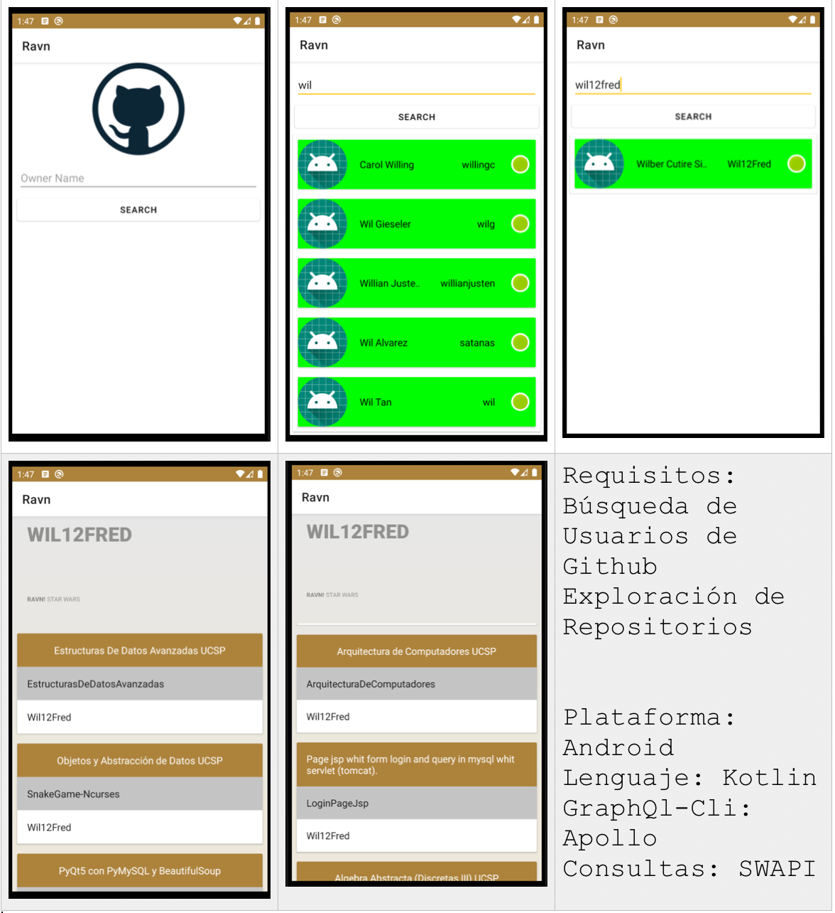

# github-graphql-android

[](https://github.com/Wil12Fred/github-graphql-android/actions/workflows/ci.yml) [](LICENSE)

An Android app (Kotlin) that searches GitHub users and their repositories through
the **GitHub GraphQL API v4**, using [Apollo Android](https://github.com/apollographql/apollo-kotlin)
1.2 code generation and cursor-based pagination.



## Features

- Search GitHub users by text; results arrive 5 at a time and the next page is
  fetched with the `endCursor` of the previous one when the list is scrolled to the
  top (up to 50 users).
- Tap a user to list the repositories returned by the search query `org:<login>`
  (name, owner, description).
- Typed queries generated by Apollo from `app/src/main/graphql/*.graphql` and the
  committed GitHub `schema.json`.
- The API token is injected at build time (`BuildConfig.GITHUB_TOKEN`), never
  committed.
- Stack: Kotlin 1.3, Apollo 1.2, RecyclerView, Glide, AndroidX.

## Requirements

- **JDK 8** — Android Gradle Plugin 3.5.1 / Gradle 5.4.1 do not run on newer JDKs.
  Debian/Ubuntu: `openjdk-8-jdk` (or Temurin 8); Arch: `jdk8-openjdk`.
- **Android SDK** with `platforms;android-28` and `build-tools;28.0.3`
  (`ANDROID_HOME` pointing at it). Install with `sdkmanager` from the Android
  command-line tools (Arch AUR: `android-sdk-cmdline-tools-latest`).
- A device or emulator with Android 8.0+ (minSdk 26) to run it.
- To run it (not to build it): a GitHub personal access token — the GraphQL API
  rejects anonymous requests. See `.env.example`.

## Build

```sh
export JAVA_HOME=/path/to/jdk8
export ANDROID_HOME=$HOME/Android/Sdk
export GITHUB_TOKEN=<your token>     # optional for the build, required at runtime
./gradlew assembleDebug
```

The token can also be given as the Gradle property `githubToken`
(e.g. in `~/.gradle/gradle.properties`). Without it the app builds, but every
query fails with HTTP 401.

## Run

```sh
./gradlew installDebug      # on a connected device or running emulator
```

Output of a real build (`./gradlew assembleDebug testDebugUnitTest`, JDK 8):

```
BUILD SUCCESSFUL in 5s
35 actionable tasks: 8 executed, 27 up-to-date
```

```
$ aapt dump badging app/build/outputs/apk/debug/app-debug.apk | head -3
package: name='com.example.githubsearch' versionCode='2' versionName='2.0' compileSdkVersion='28' compileSdkVersionCodename='9'
sdkVersion:'26'
targetSdkVersion:'28'
```

The screenshot above shows the user search running on a device.

## Tests

```sh
./gradlew testDebugUnitTest
# report: app/build/reports/tests/testDebugUnitTest/index.html
```

JVM unit tests (no network, no token, no device) in
`app/src/test/.../models/SearchResultsTest.kt` cover the logic in
`models/SearchResults.kt` that both screens use:

- mapping a repository edge to `GithubRepo` puts owner and description in the
  right fields, and a repository without a description is kept (empty text);
- a user without a display name is shown by login, and incomplete edges are
  dropped instead of crashing;
- a page is prepended in the order the list shows it and the returned count is
  the exact number of inserted rows;
- the next page is requested only at the top of the list, with a cursor, below
  the 50-user limit.

CI (`.github/workflows/ci.yml`) runs `assembleDebug testDebugUnitTest` on every
push and pull request, without a token. The instrumented test in
`app/src/androidTest` is the template placeholder and is not run in CI.

## Project layout

```
app/src/main/graphql/            GraphQL queries + GitHub schema.json (Apollo codegen input)
app/src/main/java/com/example/githubsearch/
  view/MainActivity.kt           user search with pagination
  view/RepositoriesActivity.kt   repositories of the selected user
  adapters/                      RecyclerView adapters
  models/                        GithubUser, GithubRepo, SearchResults (testable logic)
  utilities/ApolloUtils.kt       Apollo client with the Authorization header
  utilities/Constants.kt         API URL + token from BuildConfig
app/src/test/                    JVM unit tests
docs/screenshot.png
```

## Known limitations

- The token is compiled into the APK, so anyone with the APK can extract it. Use a
  token with no scopes (public data only) and never distribute a build that has one.
- The toolchain is from 2019: AGP 3.5.1, Gradle 5.4.1, Kotlin 1.3.41, JDK 8 only.
  Dependencies resolve from `jcenter()`, which is read-only and may disappear;
  `kotlin-android-extensions` (synthetic views) is deprecated.
- Several declared dependencies are unused (Retrofit, RxJava, Dagger, Timber,
  ComplexView), as are the `FindRepoQuery` and `ListRepoAfterUserQuery` queries;
  the repositories screen shows only the first 10 results, with no pagination.
- Errors are only logged: a failed request (no token, no network, rate limit)
  leaves the list empty with no message, and the user screen's progress bar stays
  visible after a failure.
- Users are inserted at the top of the list and the next page loads when scrolling
  *up* to the first item — an unusual direction kept as the original design.
- Leftover template resources (placeholder images, unused layouts) remain in `res/`.

## Background

Written in November 2019 as a take-home exercise for a job interview: a small
Android client for a GraphQL API with pagination. Tests, CI and the bug fixes
listed in the history were added in 2026.

## License

MIT — see [LICENSE](LICENSE).
